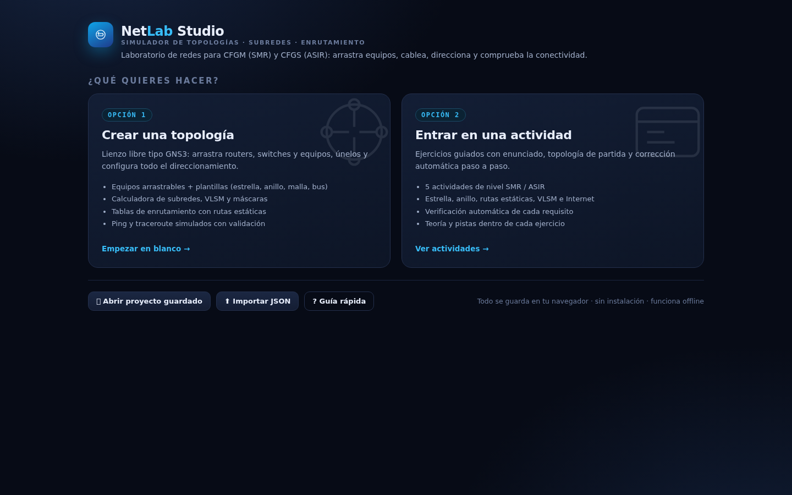

# NetLab Studio

Entorno de simulación de redes tipo **GNS3**, pensado para estudio en **CFGM (SMR)** y **CFGS (ASIR)**.
Todo funciona en el navegador: no requiere instalación ni conexión a Internet.



---

## Arrancar

```bash
cd netlab
python3 server.py 8000
# abre http://localhost:8000
```

También puedes abrir `index.html` directamente con doble clic (funciona sin servidor).

---

## Las dos puertas de entrada

Al abrir la aplicación eliges:

### 1 · Crear una topología
Lienzo libre tipo GNS3:

| Acción | Cómo |
|---|---|
| Añadir equipo | Arrastrar la tarjeta al lienzo (o hacer clic en ella) |
| Crear cable | Arrastrar desde un **puerto** ⚪ (aparecen al pasar el ratón) hasta otro equipo |
| Configurar | Clic en el equipo → panel derecho (IP, máscara, gateway, rutas) |
| Mover / zoom | Arrastrar el equipo · rueda del ratón · arrastrar el fondo |
| Menú | Botón derecho: renombrar, duplicar, ping, eliminar |
| Atajos | `Supr` borrar · `Ctrl+Z` deshacer · `Ctrl+S` guardar · `F` ajustar vista |

**Equipos:** Router, Switch, Hub, PC, Portátil, Servidor, Firewall e Internet (nube).
**Plantillas ya cableadas:** estrella, anillo, malla, bus y "dos sedes".

### Servidores con roles y clientes DHCP

Un **servidor** puede desempeñar los tres roles a la vez (se activan en su panel derecho,
con puntos verdes de estado en el propio nodo del lienzo):

| Rol | Configuración |
|---|---|
| **DHCP** | Ámbito (red/máscara CIDR), rango dinámico inicio–fin, **exclusiones**, **reservas por MAC**, puerta de enlace (opc. 3), DNS (opc. 6), dominio (opc. 15), tiempo de concesión, interfaz de servicio y varios ámbitos por servidor |
| **Web (HTTP)** | Sitios con nombre/alias, título y contenido HTML. El navegador del cliente resuelve el nombre, comprueba la conectividad IP y muestra la página |
| **Correo (POP3/SMTP)** | Dominio, puertos SMTP/POP3, buzones con usuario/contraseña y bandeja. Envío entre buzones del mismo servidor o con *relay* a otro servidor si hay ruta IP |

Cada interfaz de un cliente (PC/portátil/servidor) puede estar en **IP estática** o en **DHCP**.
En modo DHCP el cliente ejecuta el proceso **DORA** real contra el servidor del mismo segmento:

```
→ DHCPDISCOVER · PC1 (00:1A:2B:E4:46:34) · broadcast FF:FF:FF:FF:FF:FF
→ DHCPREQUEST · PC1 solicita 192.168.50.100 a SRV1
← DHCPACK · SRV1: 192.168.50.100/24 · gw 192.168.50.1 · DNS 192.168.50.10 · concesión 1440 min
```

El motor tiene en cuenta lo importante: DISCOVER es broadcast y **no cruza routers**, el pool debe
corresponder a una red que el servidor tenga configurada en ese segmento, se respetan exclusiones y
reservas, y no se entrega una IP que ya esté en uso en la topología.

### 2 · Entrar en una actividad
Cinco ejercicios con enunciado, teoría, topología inicial preparada y **corrección automática**:

| Actividad | Nivel | Contenido |
|---|---|---|
| Topología en estrella | CFGM / 1º ASIR | Switch + 4 PC en `192.168.10.0/24` |
| Anillo de switches | CFGM / 1º ASIR | 3 switches en bucle, redundancia y STP |
| Dos LANs y rutas estáticas | CFGS · ASIR | 2 routers, enlace `/30`, rutas de ida y vuelta |
| Subnetting VLSM | CFGS · ASIR | Reparto de una `/24` en 100/40/12 hosts |
| Sucursal con Internet | CFGS · ASIR | Ruta por defecto `0.0.0.0/0`, WAN y NAT |
| Servicios de red: DHCP, web y correo | CFGS · ASIR | Servidor con 3 roles + clientes DHCP + navegador + POP3 |
| DHCP: exclusiones y reservas por MAC | CFGS · ASIR | Ámbito, rango, exclusiones y reserva fija por hardware |

Cada actividad incluye botón **Comprobar** con checklist detallada, **Ver solución** y **Reiniciar**.

---

## Barra lateral izquierda

### Subredes
- **Calculadora IP**: red, máscara, wildcard, broadcast, rango útil, nº de hosts, clase (A/B/C), tipo (privada/pública/link-local) y representación **binaria**.
- **Dividir en subredes**: genera todas las subredes de un prefijo mayor con su rango.
- **VLSM**: introduces los hosts necesarios por departamento y calcula los bloques ordenados de mayor a menor, con direcciones alineadas y hueco restante.

### Rutas
- **Tabla de enrutamiento** del equipo seleccionado (conectadas `C` y estáticas `S`).
- **Añadir ruta estática** (destino CIDR + next hop o interfaz).
- **Traza**: consulta qué ruta usaría un equipo hacia una IP (longest prefix match).

### Servicios
Estado de cada servidor (DHCP / HTTP / POP3), lista de clientes en modo DHCP con su MAC y
concesiones activas. Botones **Renovar DHCP** (lanza DORA en todos los clientes) y **Concesiones**.

### Validar
Diagnóstico completo: IPs duplicadas, direcciones de red/broadcast asignadas a interfaces,
gateways inexistentes o fuera de la subred, rutas inválidas, equipos aislados y sin IP.

### Tarea (solo en actividades)
Enunciado, objetivos, progreso y corrección en vivo.

---

## Simulación real de conectividad

El motor **no dibuja flechas**: emula el reenvío.

1. Consulta la **tabla de rutas**: primero redes conectadas, luego estáticas (gana el prefijo más específico) y por último la puerta de enlace del host.
2. **Resuelve ARP** en cada segmento: busca al vecino atravesando switches y hubs (dominio de difusión).
3. Recorre los routers salto a salto hasta el destino.
4. Comprueba también la **ruta de vuelta** (el error más habitual: la ida funciona y el ping no).
5. Aplica **NAT/PAT** simplificado si un origen privado sale por una interfaz pública.

Disponible en ⚙ **Ping**, **Traceroute** (resalta el camino en el lienzo) y en la **consola**:

```
help
devices
show topology
show ip route R1
show interfaces PC1
ping PC1 192.168.2.10
tracert PC1 8.8.8.8
dhcp renew [equipo]        renovación DORA
ipconfig PC1              IP, MAC y estado de la concesión
http PC1 intranet         abrir un sitio web del servidor
mail                      buzones y dominios
services                  roles activos de cada servidor
check
```

---

## Guardado

- **Autoguardado** de la sesión en `localStorage` (botón "Continuar sesión anterior" al inicio).
- **Proyectos** con nombre (💾 guardar, 📂 abrir).
- **Exportar / Importar JSON** para entregar prácticas o compartirlas.
- Las actividades completadas se marcan con ✓ en el listado.

---

## Estructura

```
netlab/
├── index.html          interfaz (inicio, actividades, workspace)
├── server.py           servidor estático de desarrollo
├── tests.js            pruebas del motor (node tests.js)
├── css/style.css       tema oscuro tipo NOC
└── js/
    ├── ipcalc.js       cálculos IP: máscaras, subredes, VLSM, binario
    ├── model.js        modelo de datos: equipos, interfaces, enlaces, rutas
    ├── sim.js          motor L2/L3: ARP, rutas, ping, traceroute, diagnóstico
    ├── services.js     DHCP (DORA), HTTP y correo POP3/SMTP simulados
    ├── activities.js   las 5 actividades + topologías inicial/solución + checker
    └── app.js          interfaz: lienzo SVG, inspector, paneles, consola
```

### Añadir una actividad nueva

En `js/activities.js` añade un objeto y mételo en el array `ACTIVITIES`:

```js
const act6 = {
  id: 'mi-actividad',
  level: 'CFGS · ASIR',
  title: 'Mi actividad',
  tagline: 'Descripción corta',
  mins: 30,
  tags: ['ospf'],
  goals: ['...'],
  briefing: `<p>Enunciado en HTML…</p>`,
  theory: `<h4>Teoría</h4><p>…</p>`,
  solution: () => build('Solución', [ /* nodos */ ], [ /* enlaces */ ]),
  initial:  () => /* topología de partida */,
  check(state) {
    return [{ id: 'x', text: 'Requisito', ok: true, msg: 'detalle' }];
  }
};
```

Para actividades con servidores, los servicios se declaran en el 7º argumento de `mk(...)`:

```js
mk('server', 'SRV1', 150, 90, [{ name: 'eth0', ip: '192.168.50.10', prefix: 24 }], [], {
  services: {
    dhcp: { enabled: true, pools: [{ network: '192.168.50.0/24', rangeStart: '192.168.50.100',
              rangeEnd: '192.168.50.150', gateway: '192.168.50.1', dns: ['192.168.50.10'],
              domain: 'aula.local', leaseMin: 1440, excluded: [], reservations: [
                { mac: '00:1A:2B:0F:22:77', ip: '192.168.50.50' } ] }] },
    web:  { enabled: true, sites: [{ name: 'intranet.aula.local', title: 'Intranet', body: '<h1>Hola</h1>' }] },
    mail: { enabled: true, domain: 'aula.local', pop3: 110, smtp: 25,
            users: [{ user: 'alumno', password: 'asir2024', box: [] }] }
  }
})
```

---

## Compatibilidad

Chrome, Edge, Firefox y Safari recientes. Sin dependencias externas ni `node_modules`.
En pantallas de menos de ~1100 px conviene trabajar con la ventana maximizada.
